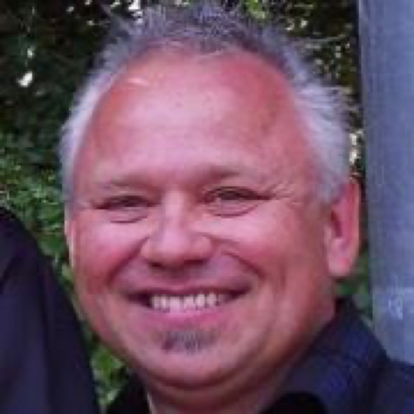

# Nelson

_Photo: the CalCompute public website's people images, used with CalCompute's permission. Copied 2026-10-26._

## Sources

- [Apereo Foundation homepage](../sources/Apereo%20Foundation%20homepage.md)
- [CNCF landscape](../sources/CNCF%20landscape.md)
- [cncf landscape2 on GitHub](../sources/cncf%20landscape2%20on%20GitHub.md)
- [UC Regents B4 Update on AI 2026-09-16](../sources/UC%20Regents%20B4%20Update%20on%20AI%202026-09-16.md)
